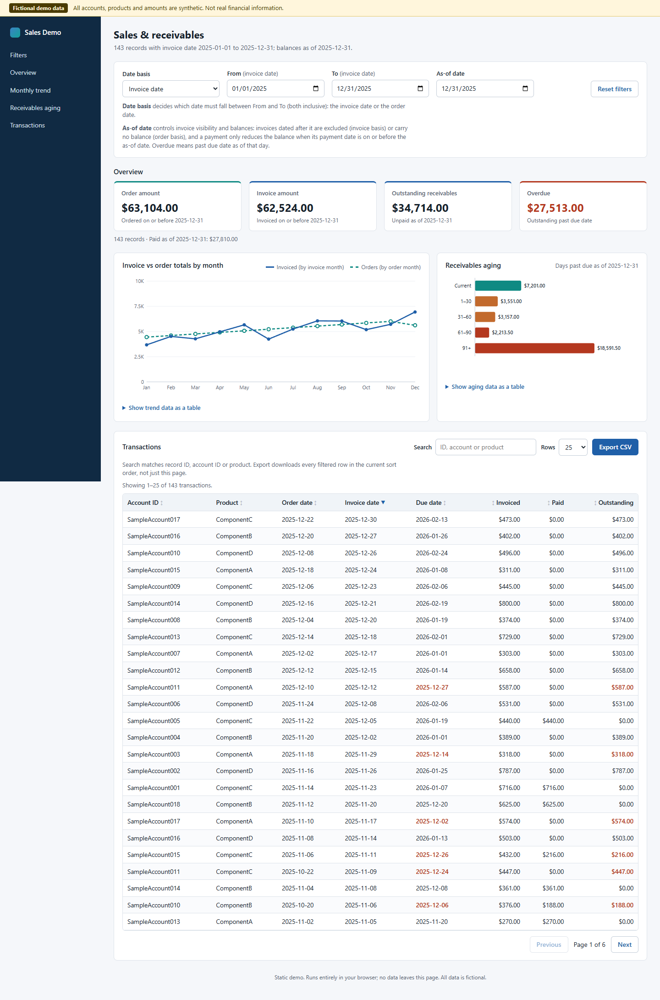

# Sales Ledger Demo



A small, dependency-free sales and receivables dashboard built around **entirely fictional data**. Compare order and invoice dates, inspect outstanding balances at a fixed date, search the ledger and export the filtered rows.

This is an independent portfolio demonstration. It has no ERP connection, accounts, upload endpoint, credentials, cloud service, analytics or financial-advice feature. No original business source, customer data, spreadsheets, company identifiers or private history was used to build it.

## Run locally

Install Node.js 22 or newer, then run from this folder:

```sh
npm start
```

Open `http://127.0.0.1:4173`. No package installation is needed. The server binds only to the local computer and serves an explicit allowlist of five frontend files. Alternatively, use `python -m http.server 4173 --bind 127.0.0.1` in this folder. ES modules need an HTTP origin; opening `index.html` directly as a file is unsupported.

Run the pure calculation tests with:

```sh
npm test
```

## A useful walkthrough

1. Start with the fixed 2025 date range and 2025-12-31 as-of date.
2. Switch between invoice date and order date. This changes which **rows** are selected, rather than silently giving each card a different filter.
3. Move the as-of date earlier to see invoices and payments disappear from balances until their own dates arrive.
4. Search `SampleAccount001` or `ComponentA`. The cards, charts, table and CSV use the same selected cohort.
5. Export CSV. It contains the current rows and as-of paid/outstanding values, with decimal USD amounts and formula-safe text.

## What the numbers mean

- Amounts are nonnegative integer **USD cents**. Formatting rounds only at display time. This is a single-currency example.
- From/To are inclusive calendar dates in UTC. Invalid/reversed ranges show an error rather than quietly changing the dates.
- Date basis chooses the order or invoice column used for row selection. Invoice basis additionally excludes invoices dated after as-of. Order basis may retain an order awaiting a future invoice; that invoice contributes zero to as-of invoiced/receivables totals.
- Order amount is counted once the order date arrives. Invoiced amount is counted once the invoice date arrives. Paid amount is counted only once its payment date arrives. Outstanding is invoiced minus paid **as of the selected day**.
- Each fictional record has at most one aggregated payment. There is no allocation ledger, payment reversal, credit note, tax, currency conversion, inventory valuation or bank reconciliation.
- Aging measures whole calendar days past due on outstanding invoices: Current includes the due date and future due dates; 1–30, 31–60, 61–90 and 91+ use non-overlapping day boundaries.
- Monthly comparisons group selected rows by each record's natural order and invoice month. The series are limited by as-of and reconcile to the cards; changing the date basis selects a different cohort.

## Fictional fixture and schema

`data.js` creates 144 records with fixed arithmetic and UTC dates. Reloading produces the same data. Accounts are `SampleAccount001` through `SampleAccount018`; products are `ComponentA` through `ComponentD`. These identifiers are invented placeholders, not anonymized real entities.

| Field | Meaning |
| --- | --- |
| `id` | Unique fictional order identifier |
| `accountId`, `product` | Bounded synthetic text labels |
| `orderDate`, `invoiceDate`, `dueDate` | Strict `YYYY-MM-DD` calendar dates |
| `orderAmount`, `invoiceAmount`, `paidAmount` | Nonnegative integer USD cents |
| `paymentDate` | Date of the single aggregated payment, or null when unpaid |

`validateRecords` enforces unique IDs, strict dates, bounded strings and amounts, sensible ordering and payment consistency. It supports at most 10,000 rows. This edition deliberately has **no import control**: replacing the fixture requires changing source, validating the new records and reviewing what will be published.

## Privacy and design decisions

All application resources are local. The browser has no data-fetch API calls and writes no application data to browser storage. CSV export creates a local download; it does not transmit data. The Node server adds a restrictive content security policy. A loaded page remains interactive without a network; initial loading and reloading still require the local static server. No service worker is installed.

The research notes in [docs/research.md](docs/research.md) record public BI examples and issue-derived testing decisions. No code, assets or datasets were copied from those projects. The UI and SVG charts are authored for this example, with system fonts.

Codex coordinated this build and wrote the fixture, calculations, tests and documentation. The installed Claude Code led the HTML/CSS/browser UI implementation. All results need human review before use beyond this demonstration. See [docs/provenance.md](docs/provenance.md) for the source boundary and licensing.

## Scope and limitations

This project demonstrates frontend state, accessible chart alternatives, deterministic fixtures, financial arithmetic and testable date semantics. It is not a production accounting system, a live financial feed or evidence of a deployed business integration. The fixture is intentionally small; the table is not designed for large datasets. Browser checks supplement the unit tests but do not establish compatibility with every device or assistive technology.

MIT license. Copyright (c) 2026 Jgolding1998.
